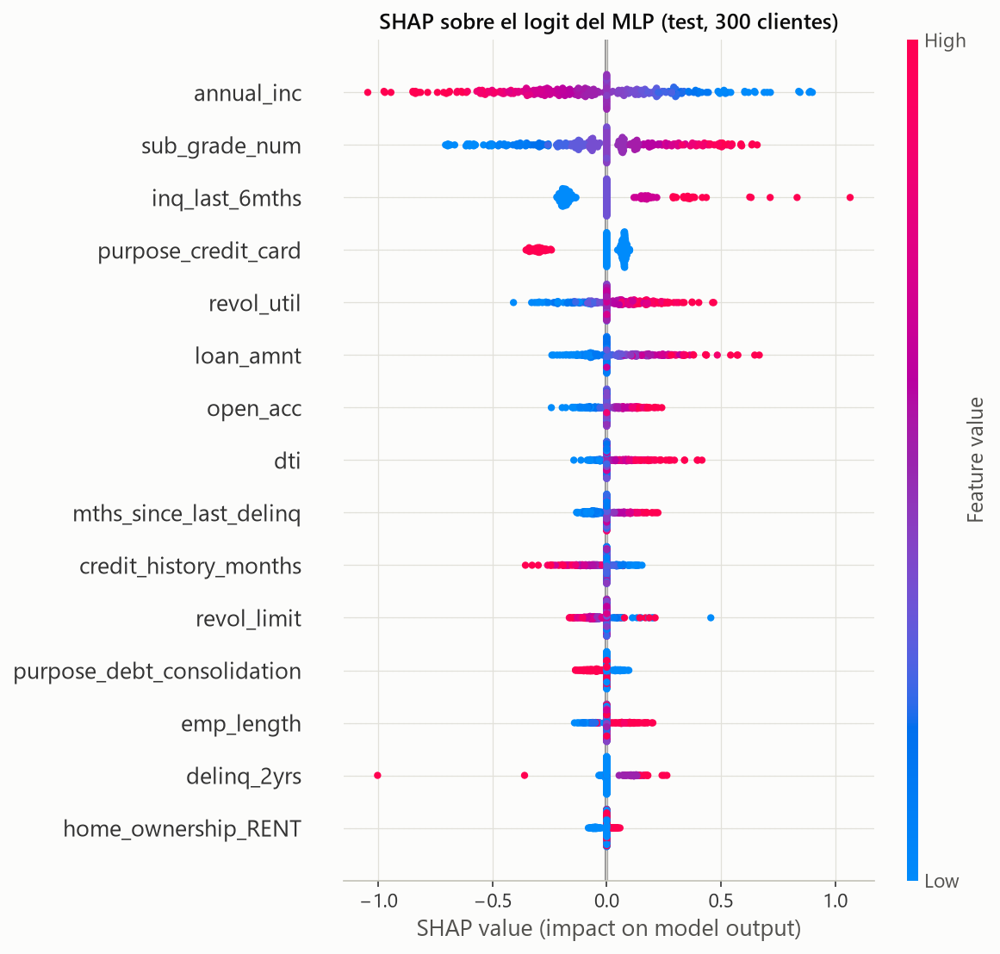
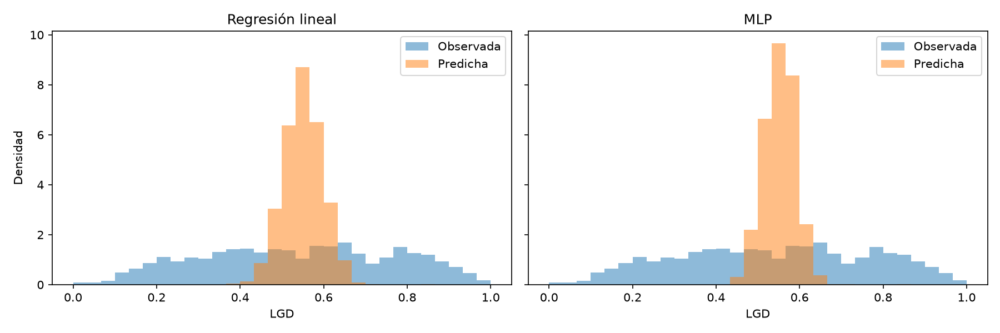

# ¿Puede una red neuronal anticipar el riesgo de un crédito?

> **Entrada de prueba.** Borrador de divulgación basado en los resultados
> guardados del proyecto. No constituye asesoría financiera ni una evaluación
> para tomar decisiones reales de crédito.

Predecir si un crédito terminará en incumplimiento parece, a primera vista, una
tarea hecha para redes neuronales. Pero cuando se comparan con una regresión
logística —un método más sencillo y fácil de explicar— la pregunta importante
no es cuál modelo suena más moderno, sino cuánto mejora y qué se sacrifica para
conseguirlo.

En este proyecto analizamos créditos de Lending Club para estudiar dos partes
del riesgo: la **probabilidad de incumplimiento (PD)** y la **pérdida dado el
incumplimiento (LGD)**. La prueba principal usa 15.136 créditos originados en el
último trimestre de 2012, separados temporalmente de los datos utilizados para
entrenar.

## Comparar sin mirar al futuro

El conjunto contiene 78.302 créditos con desenlace conocido y originados entre
2007 y 2012. Se dividió cronológicamente: entrenamiento hasta junio de 2012,
validación durante el tercer trimestre y prueba durante el cuarto. Esta
separación permite evaluar los modelos en créditos posteriores a los usados
para ajustarlos, en lugar de mezclar al azar distintos momentos del tiempo.

Para estimar la PD comparamos una regresión logística con un perceptrón
multicapa (MLP). Ambos usan información disponible al originar el crédito; las
variables conocidas después, como pagos o recuperaciones, no se usan como
predictores de PD.

## Una mejora real, pero pequeña

En la prueba, la regresión logística obtuvo un AUC de **0,638** y el MLP
guardado, **0,645**. El AUC mide qué tan bien se ordenan los créditos con mayor
riesgo por encima de los de menor riesgo; no es la probabilidad de acertar cada
caso ni una garantía de que una predicción individual sea correcta.

Un bootstrap pareado estimó una diferencia de AUC de **+0,007** a favor del
MLP, con un intervalo de confianza del 95 % entre **+0,002 y +0,012**. La
diferencia es estadísticamente detectable en esta muestra, pero su magnitud es
modesta. En calibración, medida por Brier, los dos modelos también quedaron muy
cerca: **0,1110** para la logística y **0,1106** para el MLP guardado.

| Métrica en prueba | Regresión logística | MLP guardado |
|---|---:|---:|
| AUC | 0,6380 | 0,6451 |
| KS | 0,2060 | 0,2200 |
| Brier | 0,1110 | 0,1106 |
| Log-loss | 0,3755 | 0,3739 |
| Parámetros entrenables | 38 | 13.185 |

El MLP medio de 30 semillas alcanzó un AUC de **0,6413**. Esto ayuda a poner la
variabilidad entre inicializaciones en contexto: la red guardada fue la mejor
de acuerdo con el criterio de validación utilizado, pero no representa por sí
sola el resultado promedio de todas las corridas.

La complejidad también cuenta. El modelo MLP guardado tiene 13.185 parámetros
entrenables frente a 38 en la logística, y es menos directo de explicar. Para
este caso, la logística ofrece una alternativa competitiva que además permite
presentar una scorecard.

## El umbral cambia la historia

Las probabilidades no se convierten en una etiqueta de “bueno” o “malo” hasta
elegir un umbral. Con el umbral predeterminado de **0,5**, prácticamente ningún
crédito supera el corte; la accuracy queda en **86,9 %**, pero la sensibilidad
es cero. Un número de accuracy alto puede ocultar así que el modelo no detecta
ningún incumplimiento.

Al elegir el umbral que maximiza F1 en validación y mantenerlo fijo para prueba,
la logística obtuvo accuracy de **65,9 %** y F1 de **0,282**. El MLP obtuvo
**66,0 %** y **0,292**, respectivamente. La sensibilidad fue de 51,2 % para la
logística y 53,7 % para el MLP. El intercambio es claro: se detectan más casos
malos, pero también se clasifican más créditos buenos como riesgosos. El umbral
es una decisión de evaluación, no una propiedad universal del modelo.

## ¿Qué señales aparecen en los datos?

En los dos modelos, las variables con mayor importancia SHAP incluyen el
ingreso anual, la subcalificación de Lending Club, las consultas crediticias
recientes, el propósito del préstamo y la utilización del crédito rotativo.
SHAP resume cuánto contribuyen las variables a las predicciones del modelo; no
demuestra que cambiar una característica vaya a causar un cambio en el riesgo.

Al comparar escenarios manteniendo las otras variables fijas, el ingreso anual
y la subcalificación mostraron efectos relevantes en ambos modelos. Por
ejemplo, al mover la subcalificación de su percentil 25 al 75, la PD media
aumentó **4,01 puntos porcentuales** en la logística y **5,78 puntos** en el
MLP. Este es un contraste del modelo sobre datos históricos, no una conclusión
causal sobre una persona.



## De la probabilidad a la severidad de la pérdida

La segunda parte estima LGD: la fracción de pérdida observada en préstamos
castigados. La prueba cuenta con **1.890 créditos con LGD observada**. En esa
muestra, la regresión lineal obtuvo MAE **0,1926** y RMSE **0,2282**; el ensamble
de 30 MLP guardados obtuvo MAE **0,1923** y RMSE **0,2273**. La referencia
constante tuvo MAE **0,1949** y RMSE **0,2308**.

La mejora del MLP frente a la regresión lineal es pequeña. Además, esta LGD
representa pérdida acumulada respecto del monto financiado al origen, utiliza
recuperaciones observadas hasta la fecha de corte y se recorta al intervalo
`[0, 1]`. No es la severidad estándar calculada sobre el saldo exacto en la
fecha de incumplimiento.

El proyecto también calcula un **proxy indicativo** por crédito:

```text
PD predicha × LGD predicha × monto financiado al origen
```

Debe leerse con cautela: el target de PD incluye préstamos atrasados además de
los castigados, mientras que la LGD observada solo se calcula para estados
`Charged Off`. El monto corresponde al origen y las recuperaciones pueden estar
censuradas. Por eso el proxy no equivale a una pérdida esperada estándar ni
está validado contra pérdidas realizadas.



## Qué nos llevamos

En estos datos, la red neuronal mejora ligeramente el ordenamiento del riesgo,
pero no cambia radicalmente el resultado. La regresión logística conserva una
ventaja práctica: tiene muchos menos parámetros y puede convertirse en una
scorecard interpretable. Para LGD, los modelos también quedan próximos en
métricas de error.

La conclusión no es que un método sea siempre mejor. Es que las métricas deben
leerse junto con el diseño temporal, el umbral, la calibración, el costo de
complejidad y las limitaciones de las etiquetas. Antes de usar estos resultados
fuera del ejercicio académico harían falta datos más actuales, validación
adicional, revisión de sesgos y controles de uso.

### Fuentes del proyecto

- [Resumen de resultados PD](../parte1/salidas/resultados/pd_resumen.md)
- [Conclusiones del análisis PD](../parte1/documentos/eda_y_conclusiones.md)
- [README del proyecto](../README.md)
