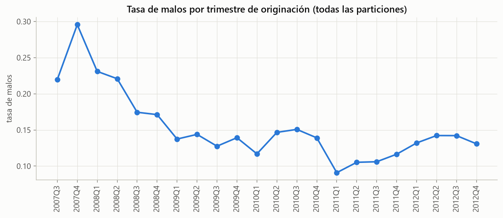
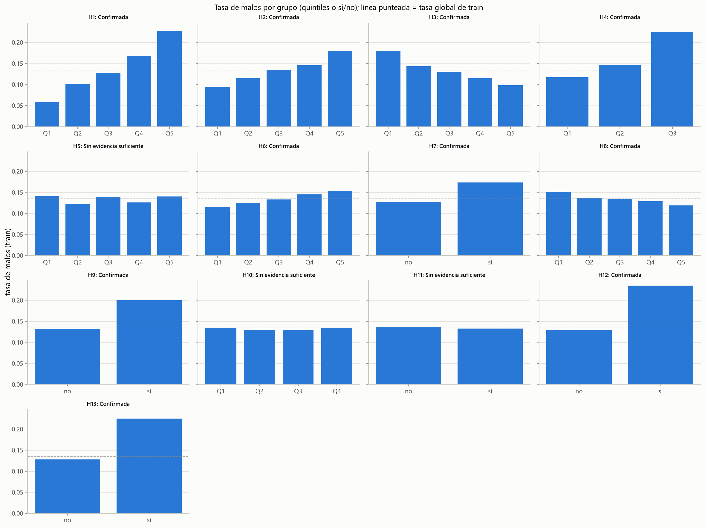
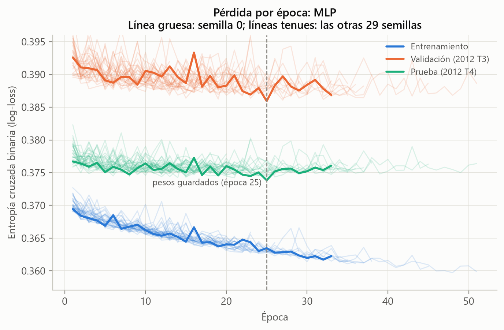
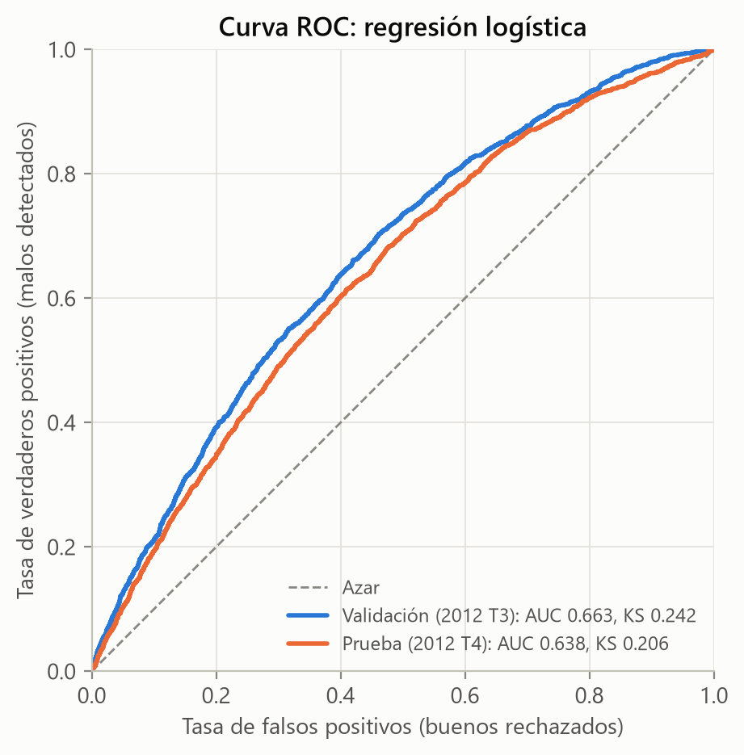
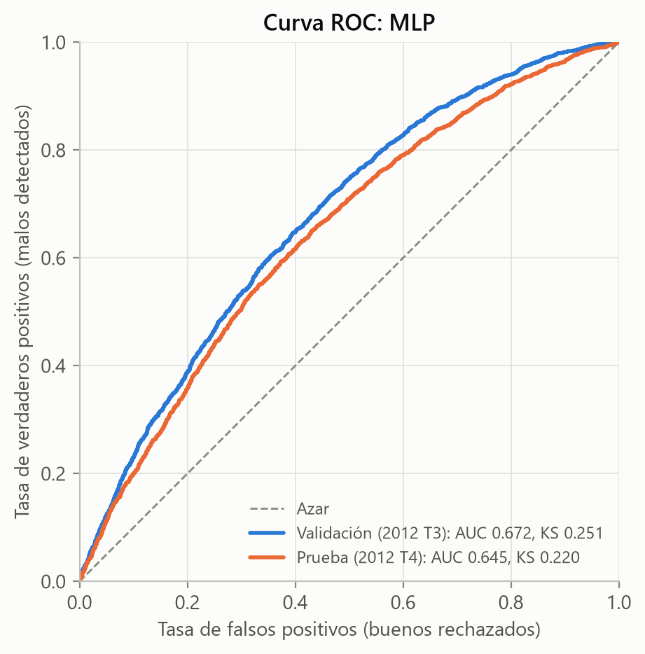
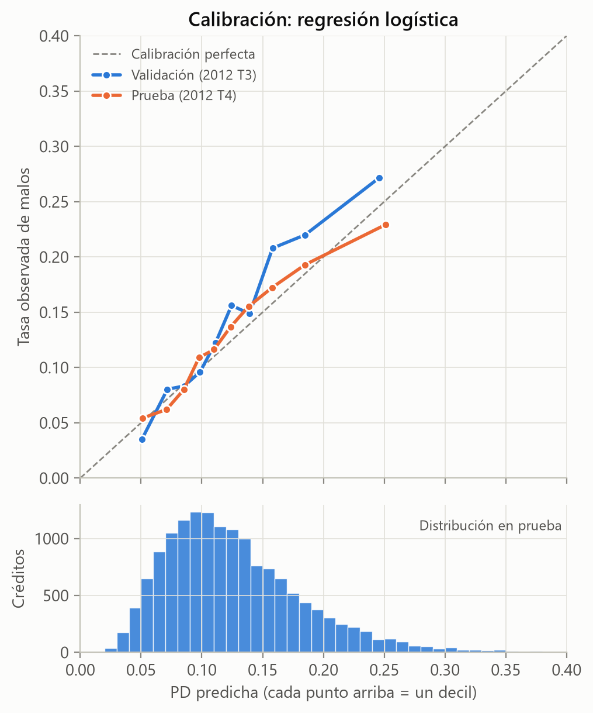
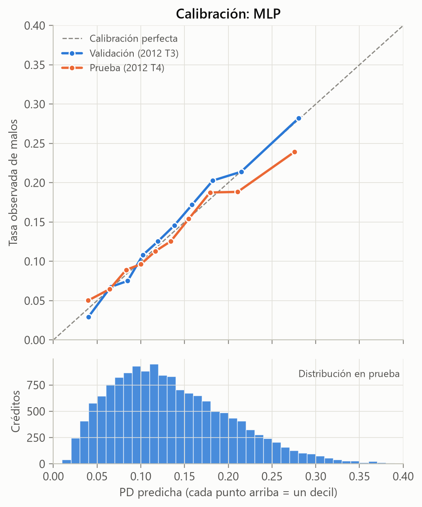
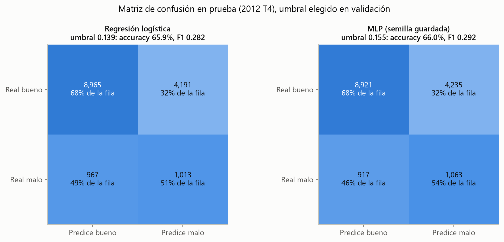
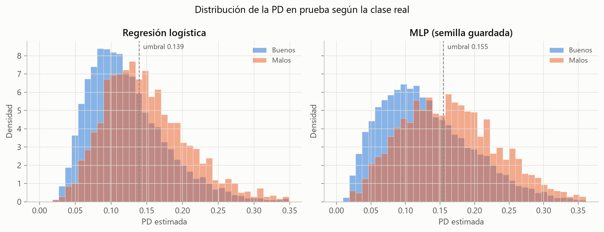

# Resumen

Este trabajo estima la probabilidad de incumplimiento (PD) de créditos de consumo de la plataforma Lending Club y compara una regresión logística con un perceptrón multicapa (MLP). El caso de uso es el de un inversionista que decide si fondear un crédito publicado. Por eso solo se usa información disponible antes del desembolso.

**Muestra.** Para evitar el sesgo de censura se trabaja solo con créditos cuyo plazo ya había vencido: 78.302 créditos, de los cuales 74.930 son a 36 meses (originados entre junio de 2007 y diciembre de 2012) y 3.372 a 60 meses (originados en 2010). La partición es temporal según la fecha de originación.

**Modelos.** La arquitectura y los hiperparámetros del MLP se eligieron por búsqueda aleatoria entre 25 configuraciones. La configuración final se entrenó con 30 semillas.

**Resultados en prueba (último trimestre de 2012).** La regresión logística obtiene un AUC de 0,638 y un puntaje de Brier de 0,1110. El MLP obtiene en promedio, sobre 30 semillas, un AUC de 0,641 ± 0,002 y el mismo Brier (0,1111); el modelo guardado, elegido por validación, alcanza 0,645. Esa ventaja de 0,007 en AUC es estadísticamente significativa (intervalo de confianza del 95 %: [0,002; 0,012]), pero pequeña, y cuesta 347 veces más parámetros y unas 500 veces más tiempo de cómputo.

**Variables de riesgo.** Los dos modelos coinciden en las cinco variables que más pesan: ingreso, subcalificación de Lending Club, utilización del crédito rotativo, consultas recientes y propósito del crédito.

**Hipótesis.** De las diez que el análisis descriptivo confirmó, siete se mantienen cuando se controla por las demás variables.

**Conclusión.** La red aporta una mejora pequeña en discriminación y ninguna en calibración: el límite lo sigue poniendo la información disponible. La regresión logística, convertida en scorecard, sigue siendo la opción más conveniente para el caso de uso.

# 1. Introducción

Antes de prestar dinero, un banco o un inversionista quiere saber qué tan probable es que no le paguen. Esa probabilidad, la PD, es la base para aprobar, fijar precio y provisionar en el riesgo de crédito (Thomas et al., 2002; Siddiqi, 2006). Modelarla es un problema de clasificación binaria sobre datos tabulares: cada crédito se describe con variables numéricas y categóricas, y el objetivo es saber si resultó "bueno" o "malo".

Las redes neuronales dominan en imágenes, texto y audio, pero en datos tabulares la evidencia es menos favorable. Varios estudios comparativos muestran que los modelos de árboles y los modelos lineales bien ajustados suelen igualarlas o superarlas (Grinsztajn et al., 2022; Shwartz-Ziv y Armon, 2022). En calificación crediticia, la regresión logística sigue siendo una referencia difícil de batir (Baesens et al., 2003; Lessmann et al., 2015). Este trabajo pone a prueba esa observación con evidencia y una comparación justa: ¿qué aporta un perceptrón multicapa frente a una regresión logística para estimar la PD?

El documento se organiza así:

- La sección 2 describe los datos, la variable objetivo y la partición.
- La sección 3 define el caso de uso.
- La sección 4 presenta el análisis descriptivo y las hipótesis.
- La sección 5 reúne la fundamentación matemática.
- La sección 6 describe la metodología experimental.
- La sección 7 presenta los resultados.
- Las secciones 8 y 9 discuten los resultados y concluyen.
- Las secciones 10 y 11 documentan el uso de inteligencia artificial y la cacería de alucinaciones.

# 2. Datos

## 2.1 Fuente

Usamos el conjunto *Credit Risk Analysis* publicado en Kaggle (Ranadeep, s.f.). Contiene los créditos de consumo que Lending Club originó en Estados Unidos.

- **Archivo:** `loan.csv`.
- **Fecha de descarga:** 24 de octubre de 2026.
- **Tamaño:** 887.379 registros y 74 variables.
- **Periodo de originación (`issue_d`):** junio de 2007 a diciembre de 2015.

Los significados de las variables se tomaron del diccionario incluido en el conjunto (`LCDataDictionary.xlsx`); la Tabla 2 los cita textualmente.

Al revisar el diccionario frente a los datos encontramos tres diferencias:

- La verificación del ingreso se llama `is_inc_v` en el diccionario y `verification_status` en los datos.
- El diccionario describe el puntaje FICO, pero ninguna columna del archivo lo contiene.
- En los créditos de 2007 y 2008, la ausencia de eventos en las variables `mths_since_last_*` ("meses desde el último…") aparece codificada como 0 y no como vacío.

## 2.2 Variable objetivo

La variable objetivo se construyó a partir de `loan_status` con la codificación del enunciado (Tabla 1). Los créditos sin desenlace conocido (NA) se excluyen, porque su comportamiento final no se observa. Quedan 268.530 créditos con desenlace; 58.819 de ellos (21,9 %) son malos.

**Tabla 1**

*Codificación de la variable objetivo a partir de `loan_status`*

| Categoría original | Créditos | Codificación |
|---|---|---|
| Fully Paid | 207.723 | 0 (bueno) |
| Does not meet the credit policy. Status:Fully Paid | 1.988 | 0 (bueno) |
| Charged Off | 45.248 | 1 (malo) |
| Default | 1.219 | 1 (malo) |
| Late (31-120 days) | 11.591 | 1 (malo) |
| Does not meet the credit policy. Status:Charged Off | 761 | 1 (malo) |
| Current | 601.779 | NA (excluido) |
| Issued | 8.460 | NA (excluido) |
| In Grace Period | 6.253 | NA (excluido) |
| Late (16-30 days) | 2.357 | NA (excluido) |

*Nota.* Elaboración propia con datos de Lending Club (Ranadeep, s.f.).

## 2.3 Sesgo de censura y selección de la muestra

Excluir los créditos vigentes introduce un sesgo. En la fecha de corte de los datos (enero de 2016), un crédito originado en 2015 solo puede tener desenlace si terminó antes de tiempo, ya sea porque se pagó por anticipado o porque cayó en impago muy pronto. Las cohortes recientes quedan entonces representadas solo por sus créditos de desenlace temprano, y su tasa de malos no es comparable con la de las cohortes antiguas.

Para evitarlo trabajamos con la muestra de **créditos vencidos**: créditos cuyo plazo completo terminó antes del corte, es decir, con fecha de originación más el plazo anterior a enero de 2016. En esa muestra todos los créditos tuvieron tiempo de mostrar su desenlace.

Para los créditos a 36 meses, eso deja los originados hasta diciembre de 2012. Para los de 60 meses, solo los originados en 2010, porque Lending Club ofrece ese plazo desde mayo de 2010: son 3.372 créditos, con 22,5 % de malos.

Incluir también los créditos a 60 meses de 2011 y 2012 que ya tenían desenlace reintroduciría el sesgo. En la cohorte del primer semestre de 2011, por ejemplo, el 24 % seguía vigente en la fecha de corte. Entre los ya resueltos la tasa de malos es 29,3 %, pero aun si todos los vigentes terminaran mal la tasa real no bajaría de 22,4 %, y lo más probable es que la mayoría termine bien. En las cohortes de 2012 la distancia llega a 14 puntos.

La muestra queda en 78.331 créditos originados entre junio de 2007 y diciembre de 2012. Se eliminaron 29 que no tenían información del buró de crédito, y quedan **78.302 créditos, con 13,5 % de malos**.

## 2.4 Variables

Una variable solo puede entrar al modelo si el inversionista la conoce al decidir (sección 3). Por eso se excluyeron cinco grupos:

1. **Información posterior a la originación:** pagos, saldos, recuperaciones, fechas del último pago. Usarla sería fuga de información.
2. **Variables casi redundantes con la subcalificación:** la tasa de interés (`int_rate`) y la cuota (`installment`); la correlación de la tasa con la subcalificación es 0,97.
3. **El estado de residencia (`addr_state`):** puede actuar como sustituto de características protegidas y tiene muchas categorías pequeñas.
4. **Variables que solo existen desde 2012:** por ejemplo `tot_cur_bal`, `total_rev_hi_lim` e `initial_list_status`. En una partición temporal funcionarían como indicadores del periodo, no del riesgo.
5. **Variables con más de 50 % de faltantes en entrenamiento, o con un solo valor en más del 99,5 % de los casos.**

La Tabla 2 lista las 19 variables que usan ambos modelos.

**Tabla 2**

*Variables de entrada y su definición según el diccionario de Lending Club*

| Variable | Definición en el diccionario (texto original) | Tratamiento |
|---|---|---|
| `loan_amnt` | "The listed amount of the loan applied for by the borrower." | Numérica |
| `term` | "The number of payments on the loan. Values are in months and can be either 36 or 60." | Numérica (36 o 60) |
| `annual_inc` | "The self-reported annual income provided by the borrower during registration." | ln(1 + x) |
| `emp_length` | "Employment length in years. Possible values are between 0 and 10 where 0 means less than one year and 10 means ten or more years." | Numérica, con indicador de faltante |
| `dti` | "A ratio calculated using the borrower's total monthly debt payments on the total debt obligations, excluding mortgage and the requested LC loan, divided by the borrower's self-reported monthly income." | Numérica |
| `delinq_2yrs` | "The number of 30+ days past-due incidences of delinquency in the borrower's credit file for the past 2 years" | Numérica |
| `inq_last_6mths` | "The number of inquiries in past 6 months (excluding auto and mortgage inquiries)" | Numérica |
| `mths_since_last_delinq` | "The number of months since the borrower's last delinquency." | Si nunca hubo mora, se llena con la antigüedad del historial |
| `open_acc` | "The number of open credit lines in the borrower's credit file." | Numérica |
| `pub_rec` | "Number of derogatory public records" | Numérica |
| `revol_util` | "Revolving line utilization rate, or the amount of credit the borrower is using relative to all available revolving credit." | Recortada en los percentiles 1 y 99 |
| `total_acc` | "The total number of credit lines currently in the borrower's credit file" | Numérica |
| `home_ownership` | "The home ownership status provided by the borrower during registration." | Categórica |
| `verification_status` (`is_inc_v`) | "Indicates if income was verified by LC, not verified, or if the income source was verified" | Categórica |
| `purpose` | "A category provided by the borrower for the loan request." | Categórica |
| `sub_grade_num` | Derivada de `sub_grade`: "LC assigned loan subgrade" | A1 = 1, …, G5 = 35 |
| `credit_history_months` | Derivada de `earliest_cr_line` ("The month the borrower's earliest reported credit line was opened") e `issue_d` | Meses entre ambas fechas |
| `never_delinquent` | Derivada de `mths_since_last_delinq` | 1 si nunca registró mora |
| `revol_limit` | Derivada de `revol_bal` ("Total credit revolving balance") y `revol_util` | `revol_bal / (revol_util / 100)`, en ln(1 + x) |

*Nota.* Definiciones citadas de `LCDataDictionary.xlsx`, incluido en el conjunto de datos (Ranadeep, s.f.).

## 2.5 Limpieza y preprocesamiento

La limpieza fija, que no depende de estadísticas de los datos, hace cuatro cosas:

1. Corrige los ceros que en 2007 y 2008 significaban "nunca" en `mths_since_last_*`.
2. Crea las variables derivadas de la Tabla 2.
3. Agrupa las categorías raras de vivienda (`NONE`, `ANY`) en `OTHER`.
4. Elimina los 29 registros sin información de buró.

El preprocesamiento estadístico se ajusta **solo con el conjunto de entrenamiento** y se aplica igual a validación y prueba:

- **Variables numéricas:**
  - logaritmo $\ln(1+x)$ para las de cola larga (ingreso y límite rotativo);
  - recorte en los percentiles 1 y 99 para la utilización rotativa;
  - imputación por la mediana, con un indicador binario de faltante;
  - estandarización a media 0 y desviación 1.
- **Variables categóricas:** codificación *one-hot*, omitiendo la primera categoría como referencia: `MORTGAGE`, `Not Verified` y `car`. Las categorías con menos de 0,5 % de los casos se agrupan.

El resultado es una matriz de 37 columnas, la misma para ambos modelos.

## 2.6 Partición temporal

La partición sigue la fecha de originación (Tabla 3). Entrenar con el pasado y evaluar con el futuro reproduce el uso real del modelo y expone la deriva temporal, que una partición aleatoria esconde (sección 7.2).

**Tabla 3**

*Partición temporal de la muestra*

| Conjunto | Periodo de originación | Créditos | Tasa de malos |
|---|---|---|---|
| Entrenamiento | junio de 2007 a junio de 2012 | 49.844 | 13,4 % |
| Validación | julio a septiembre de 2012 | 13.322 | 14,2 % |
| Prueba | octubre a diciembre de 2012 | 15.136 | 13,1 % |
| Total | junio de 2007 a diciembre de 2012 | 78.302 | 13,5 % |

*Nota.* Los 3.372 créditos a 60 meses, todos de 2010, quedan en entrenamiento, donde son el 6,8 %. Elaboración propia.

La validación se usa para elegir hiperparámetros, detener el entrenamiento y fijar umbrales. La prueba se usa una sola vez, para reportar.

# 3. Caso de uso

**Quién usa el modelo.** Un inversionista que compra fracciones de créditos de consumo publicados en Lending Club.

**Para qué decisión.** Fondear o no un crédito publicado, y con qué exposición, según la probabilidad de que el solicitante incumpla.

**En qué momento.** Cuando el crédito aparece publicado con su calificación, antes de comprometer dinero y antes de que exista cualquier pago.

**Con qué información.** Los datos de la solicitud (incluido el plazo) y del historial crediticio del solicitante, incluida la subcalificación asignada por Lending Club (`sub_grade`), que el inversionista ve en la publicación. No se usa nada que se conozca después de la originación.

Este caso de uso explica tres decisiones de modelamiento:

- La subcalificación sí entra al modelo; la tasa de interés no, por redundante con ella.
- La partición es temporal.
- La salida principal es una probabilidad calibrada, no una etiqueta de aprobado o rechazado. Con una probabilidad, el inversionista puede comparar la pérdida esperada con el interés que recibiría.

# 4. Análisis descriptivo e hipótesis

La Figura 1 muestra la tasa de malos por trimestre de originación. Hay dos regularidades:

- Las cohortes de 2007 y 2008 tienen tasas mucho más altas, cercanas a la crisis financiera, y además incluyen créditos que no cumplían la política de crédito.
- Desde 2009 la tasa se estabiliza entre 10 % y 15 %.

Esa variación en el tiempo es otra razón para usar una partición temporal.

**Figura 1**

*Tasa de malos por trimestre de originación*

{width=95%}

*Nota.* Se omiten los trimestres con menos de 100 créditos. Elaboración propia con datos de Lending Club.

**Hipótesis.** Antes de modelar formulamos trece hipótesis sobre qué hace más riesgosa a una persona (Tabla 4). Se contrastaron solo con el conjunto de entrenamiento, con tres criterios:

- **La prueba de Mann-Whitney** (Mann y Whitney, 1947), que compara la distribución de la variable entre buenos y malos.
- **El AUC univariado**, que mide cuánto separa la variable por sí sola a buenos de malos (sección 5.9).
- **Un tamaño de efecto mínimo**: $|\text{AUC} - 0{,}5| \geq 0{,}01$ para variables continuas, o una diferencia de al menos un punto porcentual en la tasa de malos para variables sí/no.

Una hipótesis se considera *confirmada* si cumple tres condiciones: el efecto es significativo ($\alpha = 0{,}01$), supera el tamaño mínimo y va en la dirección esperada.

**Tabla 4**

*Hipótesis del análisis descriptivo y su contraste en entrenamiento*

| Id | Hipótesis | Tasa de malos: grupo bajo → grupo alto | AUC univariado | Veredicto |
|---|---|---|---|---|
| H1 | Peor subcalificación de Lending Club → más riesgo | 5,9 % → 22,8 % | 0,645 | Confirmada |
| H2 | Mayor utilización del crédito rotativo → más riesgo | 9,5 % → 18,0 % | 0,572 | Confirmada |
| H3 | Mayor ingreso anual → menos riesgo | 18,0 % → 9,8 % | 0,432 | Confirmada |
| H4 | Más consultas de crédito en seis meses → más riesgo | 11,8 % → 22,5 % | 0,576 | Confirmada |
| H5 | Mayor monto del crédito → más riesgo | 14,1 % → 14,0 % | 0,499 | Sin evidencia |
| H6 | Mayor endeudamiento sobre ingreso (`dti`) → más riesgo | 11,5 % → 15,3 % | 0,534 | Confirmada |
| H7 | Moras o registros públicos previos → más riesgo | 12,8 % → 17,4 % | 0,525 | Confirmada |
| H8 | Historial crediticio más largo → menos riesgo | 15,2 % → 11,9 % | 0,472 | Confirmada |
| H9 | No informar la antigüedad laboral → más riesgo | 13,2 % → 20,0 % | 0,508 | Confirmada |
| H10 | Mayor antigüedad laboral → menos riesgo | 13,5 % → 13,4 % | 0,501 | Sin evidencia |
| H11 | Ingreso verificado → menos riesgo | 13,6 % → 13,3 % | 0,497 | Sin evidencia |
| H12 | Crédito para pequeño negocio → más riesgo | 13,0 % → 23,5 % | 0,518 | Confirmada |
| H13 | Plazo de 60 meses → más riesgo | 12,8 % → 22,5 % | 0,526 | Confirmada |

*Nota.* Para las variables continuas, los grupos son el primer y el quinto quintil; para las demás, "no" y "sí". Un AUC menor que 0,5 indica que valores altos se asocian con menos riesgo. Elaboración propia.

La Figura 2 muestra la tasa de malos por quintil o grupo de cada hipótesis. El análisis confirma diez de las trece. La variable que más discrimina por sí sola es la subcalificación de Lending Club: entre el quintil de mejor calificación y el de peor, la tasa de malos se multiplica por 3,8. Ninguna variable alcanza un AUC univariado de 0,65, así que desde el análisis descriptivo se anticipaba un problema con poca señal.

**Figura 2**

*Tasa de malos por grupo para cada hipótesis*

{width=100%}

*Nota.* Línea punteada: tasa de malos de entrenamiento (13,4 %). Elaboración propia.

# 5. Fundamentación teórica y matemática

## 5.1 Neurona artificial

Una neurona artificial recibe un vector de entradas $\mathbf{x} \in \mathbb{R}^d$. Calcula una combinación afín de esas entradas y le aplica una función de activación $\varphi$ no lineal:

$$
z = \mathbf{w}^\top \mathbf{x} + b, \qquad a = \varphi(z), \qquad (1)
$$

donde $\mathbf{w} \in \mathbb{R}^d$ son los pesos, $b \in \mathbb{R}$ es el sesgo y $a$ es la salida o activación (Goodfellow et al., 2016).

## 5.2 Perceptrón multicapa

Un perceptrón multicapa con $L$ capas ocultas compone neuronas organizadas en capas densas. Con $\mathbf{h}^{(0)} = \mathbf{x}$ y $n_l$ neuronas en la capa $l$:

$$
\mathbf{z}^{(l)} = W^{(l)} \mathbf{h}^{(l-1)} + \mathbf{b}^{(l)}, \qquad \mathbf{h}^{(l)} = \varphi\left(\mathbf{z}^{(l)}\right), \qquad l = 1, \dots, L, \qquad (2)
$$

con $W^{(l)} \in \mathbb{R}^{n_l \times n_{l-1}}$. La capa de salida tiene una sola neurona, cuyo valor es el logit de la PD; la sigmoide lo convierte en probabilidad:

$$
z^{\text{sal}} = \mathbf{w}^{\text{sal}\top} \mathbf{h}^{(L)} + b^{\text{sal}}, \qquad \hat{p} = \sigma\left(z^{\text{sal}}\right) = \frac{1}{1 + e^{-z^{\text{sal}}}}. \qquad (3)
$$

El número de parámetros entrenables es

$$
\sum_{l=1}^{L+1} (n_{l-1} + 1)\, n_l . \qquad (4)
$$

Para la arquitectura final ($37 \to 128 \to 64 \to 1$) eso da $38 \cdot 128 + 129 \cdot 64 + 65 \cdot 1 = 13.185$ parámetros.

La regresión logística es el caso $L = 0$, es decir, una sola neurona con activación sigmoide.

## 5.3 Funciones de activación

La búsqueda de hiperparámetros consideró cinco activaciones para las capas ocultas, y la sigmoide se usa en la salida. Sus definiciones y derivadas, que son las que necesita la retropropagación:

- **ReLU** (Nair y Hinton, 2010):
  $$\varphi(z) = \max(0, z), \qquad \varphi'(z) = \mathbb{1}[z > 0]. \qquad (5)$$
- **Leaky ReLU** (Maas et al., 2013), con $\alpha = 0{,}01$:
  $$\varphi(z) = \max(\alpha z, z), \qquad \varphi'(z) = 1 \text{ si } z > 0, \; \alpha \text{ si no}. \qquad (6)$$
- **ELU** (Clevert et al., 2016), con $\alpha = 1$, usada en el modelo final:
  $$\varphi(z) = z \text{ si } z > 0, \quad \alpha\,(e^{z} - 1) \text{ si no}; \qquad \varphi'(z) = 1 \text{ si } z > 0, \; \varphi(z) + \alpha \text{ si no}. \qquad (7)$$
- **Tangente hiperbólica:**
  $$\varphi(z) = \tanh(z) = \frac{e^{z} - e^{-z}}{e^{z} + e^{-z}}, \qquad \varphi'(z) = 1 - \tanh^2(z). \qquad (8)$$
- **GELU** (Hendrycks y Gimpel, 2016), donde $\Phi$ y $\phi$ son la función de distribución y la densidad de la normal estándar:
  $$\varphi(z) = z\,\Phi(z), \qquad \varphi'(z) = \Phi(z) + z\,\phi(z). \qquad (9)$$
- **Sigmoide**, en la capa de salida:
  $$\sigma(z) = \frac{1}{1 + e^{-z}}, \qquad \sigma'(z) = \sigma(z)\,\bigl(1 - \sigma(z)\bigr). \qquad (10)$$

## 5.4 Función de pérdida: entropía cruzada binaria por máxima verosimilitud

Modelamos la etiqueta de cada crédito como una variable de Bernoulli cuyo parámetro depende de sus características: $y_i \mid \mathbf{x}_i \sim \text{Bernoulli}(p_i)$, con $p_i = \hat{p}(\mathbf{x}_i; \boldsymbol{\theta})$. Su función de probabilidad es $P(y_i \mid \mathbf{x}_i) = p_i^{\,y_i} (1 - p_i)^{1 - y_i}$. Si las observaciones son independientes, la verosimilitud de los parámetros $\boldsymbol{\theta}$ es

$$
\mathcal{L}(\boldsymbol{\theta}) = \prod_{i=1}^{n} p_i^{\,y_i} (1 - p_i)^{1 - y_i}. \qquad (11)
$$

Maximizar $\mathcal{L}$ equivale a minimizar el negativo de su logaritmo, promediado sobre las observaciones. El resultado es la entropía cruzada binaria, o *log-loss*:

$$
\ell(\boldsymbol{\theta}) = -\frac{1}{n} \sum_{i=1}^{n} \Bigl[ y_i \ln p_i + (1 - y_i) \ln (1 - p_i) \Bigr]. \qquad (12)
$$

Con $p_i = \sigma(z_i)$, la derivada de la pérdida de una observación respecto a su logit es particularmente simple:

$$
\frac{\partial \ell_i}{\partial z_i} = -\frac{y_i}{p_i}\, p_i (1 - p_i) + \frac{1 - y_i}{1 - p_i}\, p_i (1 - p_i) = p_i - y_i. \qquad (13)
$$

Para evitar desbordamientos numéricos, la implementación calcula la pérdida directamente desde el logit, con la forma equivalente $\ell_i = \max(z_i, 0) - z_i y_i + \ln\left(1 + e^{-|z_i|}\right)$.

## 5.5 Retropropagación

El gradiente de la pérdida respecto a todos los pesos se obtiene con la regla de la cadena, recorriendo la red desde la salida hacia la entrada (Rumelhart et al., 1986). Se define el error de cada capa como $\boldsymbol{\delta}^{(l)} = \partial \ell_i / \partial \mathbf{z}^{(l)}$. Por (13), en la salida $\delta^{\text{sal}} = \hat{p}_i - y_i$, y hacia atrás

$$
\boldsymbol{\delta}^{(l)} = \left( W^{(l+1)\top} \boldsymbol{\delta}^{(l+1)} \right) \odot \varphi'\left(\mathbf{z}^{(l)}\right), \qquad (14)
$$

donde $\odot$ es el producto elemento a elemento y $W^{(L+1)} = \mathbf{w}^{\text{sal}\top}$. Los gradientes de los parámetros de la capa $l$, promediados sobre un minilote $\mathcal{B}$, son

$$
\frac{\partial J}{\partial W^{(l)}} = \frac{1}{|\mathcal{B}|} \sum_{i \in \mathcal{B}} \boldsymbol{\delta}_i^{(l)} \mathbf{h}_i^{(l-1)\top} + 2\lambda W^{(l)}, \qquad \frac{\partial J}{\partial \mathbf{b}^{(l)}} = \frac{1}{|\mathcal{B}|} \sum_{i \in \mathcal{B}} \boldsymbol{\delta}_i^{(l)}, \qquad (15)
$$

El término $2\lambda W^{(l)}$ proviene de la penalización L2 (sección 5.7). Con dropout, $\mathbf{h}^{(l)}$ incluye la máscara de esa iteración, y el gradiente solo fluye por las neuronas activas. En la implementación, PyTorch calcula (14) y (15) automáticamente por diferenciación automática.

## 5.6 Optimizadores

Con $\mathbf{g}_t = \nabla_{\boldsymbol{\theta}} J$ evaluado en el minilote del paso $t$ y tasa de aprendizaje $\eta$, la búsqueda consideró tres reglas de actualización, en la forma en que las implementa PyTorch. Las operaciones son elemento a elemento.

**Descenso por gradiente estocástico con momento** (Polyak, 1964), con $\mu = 0{,}9$:

$$
\mathbf{v}_t = \mu\, \mathbf{v}_{t-1} + \mathbf{g}_t, \qquad \boldsymbol{\theta}_t = \boldsymbol{\theta}_{t-1} - \eta\, \mathbf{v}_t . \qquad (16)
$$

**RMSprop** (Tieleman y Hinton, 2012), con $\alpha = 0{,}99$ y $\epsilon = 10^{-8}$. Es el optimizador del modelo final:

$$
\mathbf{s}_t = \alpha\, \mathbf{s}_{t-1} + (1 - \alpha)\, \mathbf{g}_t^2, \qquad \boldsymbol{\theta}_t = \boldsymbol{\theta}_{t-1} - \eta\, \frac{\mathbf{g}_t}{\sqrt{\mathbf{s}_t} + \epsilon} . \qquad (17)
$$

**Adam** (Kingma y Ba, 2015), con $\beta_1 = 0{,}9$, $\beta_2 = 0{,}999$ y $\epsilon = 10^{-8}$:

$$
\mathbf{m}_t = \beta_1 \mathbf{m}_{t-1} + (1 - \beta_1)\, \mathbf{g}_t, \qquad \mathbf{v}_t = \beta_2 \mathbf{v}_{t-1} + (1 - \beta_2)\, \mathbf{g}_t^2, \qquad (18)
$$

$$
\hat{\mathbf{m}}_t = \frac{\mathbf{m}_t}{1 - \beta_1^t}, \qquad \hat{\mathbf{v}}_t = \frac{\mathbf{v}_t}{1 - \beta_2^t}, \qquad \boldsymbol{\theta}_t = \boldsymbol{\theta}_{t-1} - \eta\, \frac{\hat{\mathbf{m}}_t}{\sqrt{\hat{\mathbf{v}}_t} + \epsilon} . \qquad (19)
$$

## 5.7 Regularización

**Penalización L2.** Se suma a la pérdida la norma de Frobenius al cuadrado de las matrices de pesos. Los sesgos no se penalizan:

$$
J(\boldsymbol{\theta}) = \frac{1}{|\mathcal{B}|} \sum_{i \in \mathcal{B}} \ell_i + \lambda \sum_{l} \left\lVert W^{(l)} \right\rVert_F^2 . \qquad (20)
$$

La penalización encoge los pesos hacia cero y reduce la varianza del modelo. Equivale a una distribución a priori normal sobre los pesos (Goodfellow et al., 2016).

**Dropout** (Srivastava et al., 2014). Durante el entrenamiento, cada neurona oculta se apaga con probabilidad $q$, y las que quedan activas se reescalan para conservar el valor esperado:

$$
r_j \sim \text{Bernoulli}(1 - q), \qquad \tilde{h}_j = \frac{r_j\, h_j}{1 - q} . \qquad (21)
$$

En evaluación no se apaga ninguna neurona. El efecto equivale a promediar muchas subredes y evita que las neuronas se coadapten.

**Parada temprana** (Prechelt, 1998). Al final de cada época se calcula la pérdida (12) en validación y se guardan los pesos con el menor valor visto. El entrenamiento se detiene cuando pasan $P = 8$ épocas sin una mejora mayor que $10^{-6}$, o al llegar a 100 épocas, y se restauran los mejores pesos. La parada temprana limita la complejidad efectiva de la red, porque limita cuánto se alejan los pesos de su valor inicial.

## 5.8 Regresión logística de referencia

La regresión logística modela $\text{logit}(p) = \beta_0 + \boldsymbol{\beta}^\top \mathbf{x}$. Sus coeficientes se estiman minimizando la log-loss con penalización L2, en la forma que usa scikit-learn:

$$
\min_{\beta_0, \boldsymbol{\beta}} \; \frac{1}{2} \lVert \boldsymbol{\beta} \rVert_2^2 + C \sum_{i=1}^{n} \Bigl[ -y_i \ln p_i - (1 - y_i) \ln (1 - p_i) \Bigr], \qquad (22)
$$

donde $C$ es el inverso de la fuerza de la regularización. Como las variables están estandarizadas, la magnitud de los coeficientes es comparable entre variables, y $e^{\beta_j}$ es la razón de odds asociada a una desviación estándar de la variable $j$.

## 5.9 Métricas de evaluación

Sean $n_1$ malos y $n_0$ buenos, y $s$ la PD estimada.

**AUC.** Es el área bajo la curva ROC, que traza la tasa de verdaderos positivos (TPR) contra la de falsos positivos (FPR) al variar el umbral. Equivale a la probabilidad de que un malo elegido al azar reciba una PD mayor que un bueno elegido al azar (Hanley y McNeil, 1982; Fawcett, 2006). Coincide con el estadístico de Mann-Whitney normalizado:

$$
\text{AUC} = \frac{1}{n_1 n_0} \sum_{i:\, y_i = 1} \; \sum_{j:\, y_j = 0} \left( \mathbb{1}[s_i > s_j] + \tfrac{1}{2} \mathbb{1}[s_i = s_j] \right). \qquad (23)
$$

**Índice de Gini.** Es una reescala del AUC que va de 0 (azar) a 1 (separación perfecta):

$$
\text{Gini} = 2\,\text{AUC} - 1 . \qquad (24)
$$

**Estadístico KS.** Es la máxima distancia entre las funciones de distribución acumulada de la PD en malos ($F_1$) y en buenos ($F_0$). Equivale a la máxima diferencia entre TPR y FPR (Thomas et al., 2002):

$$
\text{KS} = \max_t \bigl| F_1(t) - F_0(t) \bigr| = \max_t \bigl( \text{TPR}(t) - \text{FPR}(t) \bigr). \qquad (25)
$$

**Puntaje de Brier** (Brier, 1950). Es el error cuadrático medio de la probabilidad. Mide a la vez discriminación y calibración:

$$
\text{Brier} = \frac{1}{n} \sum_{i=1}^{n} (\hat{p}_i - y_i)^2 . \qquad (26)
$$

**Curva de calibración.** Las observaciones se ordenan por PD estimada y se agrupan en deciles. Para cada decil se compara la PD media estimada con la tasa observada de malos; un modelo calibrado sigue la diagonal (Niculescu-Mizil y Caruana, 2005). Como resumen se reporta también la *calibración global*: la diferencia entre la PD media y la tasa observada.

**Accuracy, precisión, sensibilidad, especificidad y F1.** Estas métricas requieren convertir la PD en una clase con un umbral $t$: el crédito se marca como malo si $\hat{p} \geq t$. Con VP, FP, VN y FN, las celdas de la matriz de confusión:

$$
\text{Accuracy} = \frac{\text{VP} + \text{VN}}{n}, \quad \text{Precisión} = \frac{\text{VP}}{\text{VP} + \text{FP}}, \quad \text{Sensibilidad} = \frac{\text{VP}}{\text{VP} + \text{FN}}, \qquad (27)
$$

$$
\text{Especificidad} = \frac{\text{VN}}{\text{VN} + \text{FP}}, \qquad F_1 = \frac{2 \cdot \text{Precisión} \cdot \text{Sensibilidad}}{\text{Precisión} + \text{Sensibilidad}} . \qquad (28)
$$

## 5.10 Derivación de la scorecard

La scorecard expresa el riesgo como un puntaje en el que más puntos significan menos riesgo. Se define sobre las odds de ser bueno, $\text{odds} = (1 - p)/p$, mediante una transformación lineal de su logaritmo:

$$
\text{puntaje} = \text{offset} + \text{factor} \cdot \ln(\text{odds}). \qquad (29)
$$

Los dos parámetros salen de dos condiciones (Siddiqi, 2006):

1. Las odds de referencia $o_0$ reciben el puntaje base $S_0$.
2. Duplicar las odds suma PDO puntos (*points to double the odds*).

Escritas como ecuaciones:

$$
S_0 = \text{offset} + \text{factor} \cdot \ln o_0, \qquad S_0 + \text{PDO} = \text{offset} + \text{factor} \cdot \ln (2 o_0). \qquad (30)
$$

Al restar la primera ecuación de la segunda resulta $\text{PDO} = \text{factor} \cdot \ln 2$, y por tanto

$$
\text{factor} = \frac{\text{PDO}}{\ln 2}, \qquad \text{offset} = S_0 - \text{factor} \cdot \ln o_0 . \qquad (31)
$$

Para la regresión logística, $\ln(\text{odds}) = -\text{logit}(p) = -\bigl(\beta_0 + \sum_j \beta_j \tilde{x}_j\bigr)$, donde $\tilde{x}_j = (x_j - \mu_j)/s_j$ es la variable estandarizada con la media y la desviación de entrenamiento. Al sustituir en (29), el puntaje queda como una suma de puntos por variable en sus unidades originales:

$$
\text{puntaje} = \underbrace{\text{offset} - \text{factor}\left(\beta_0 - \sum_j \frac{\beta_j \mu_j}{s_j}\right)}_{\text{puntos base}} + \sum_j \underbrace{\left( -\frac{\text{factor} \cdot \beta_j}{s_j} \right)}_{\text{puntos por unidad de } x_j} x_j . \qquad (32)
$$

Así, cada variable continua aporta una cantidad fija de puntos por unidad, y cada categoría aporta una cantidad fija frente a su categoría de referencia. La scorecard admite variables continuas sin necesidad de discretizarlas.

## 5.11 Interpretabilidad: valores de Shapley (SHAP)

Para explicar qué variables vuelven más riesgosa a una persona usamos los valores de Shapley aplicados a la predicción de cada crédito (Lundberg y Lee, 2017). Sea $F$ el conjunto de variables y $f_S$ la predicción usando solo las variables del subconjunto $S$. La contribución de la variable $j$ es

$$
\phi_j = \sum_{S \subseteq F \setminus \{j\}} \frac{|S|!\,(|F| - |S| - 1)!}{|F|!} \Bigl[ f_{S \cup \{j\}}(\mathbf{x}) - f_S(\mathbf{x}) \Bigr], \qquad (33)
$$

y las contribuciones suman exactamente la predicción: $f(\mathbf{x}) = \phi_0 + \sum_j \phi_j$, con $\phi_0$ la predicción media.

Elegimos SHAP por tres razones:

- Es el único método aditivo que cumple las propiedades de eficiencia, simetría y nulidad (Lundberg y Lee, 2017).
- Se aplica igual a la red y a la logística, y por eso permite compararlas.
- Explica en la escala del logit, la misma de la scorecard.

En el MLP, (33) se aproxima con KernelSHAP: 100 créditos de entrenamiento como referencia, 300 créditos de prueba explicados y 1.000 evaluaciones por crédito. En la logística el cálculo es exacto, porque para un modelo lineal $\phi_j = \beta_j \bigl(\tilde{x}_j - \mathbb{E}[\tilde{x}_j]\bigr)$. Las columnas *one-hot* de una misma variable se suman. La importancia de cada variable es el promedio de $|\phi_j|$.

# 6. Metodología experimental

## 6.1 Regresión logística

Se ajustó la regresión (22) para cinco valores de $C$, de 0,001 a 10, y se eligió el de menor log-loss en validación (Tabla 5). A partir de $C = 0{,}01$ la diferencia entre valores es menor que $10^{-4}$: la regularización casi no cambia el resultado, porque hay 49.844 observaciones para 38 parámetros. Se eligió $C = 0{,}1$.

**Tabla 5**

*Búsqueda del parámetro de regularización de la regresión logística*

| $C$ | Log-loss en validación | AUC en validación |
|---|---|---|
| 0,001 | 0,39132 | 0,6613 |
| 0,01 | 0,39006 | 0,6630 |
| 0,1 | **0,39000** | 0,6629 |
| 1 | 0,39004 | 0,6627 |
| 10 | 0,39003 | 0,6628 |

*Nota.* Elaboración propia.

## 6.2 Perceptrón multicapa

**Método de búsqueda.** La arquitectura y los hiperparámetros se eligieron por búsqueda aleatoria (Bergstra y Bengio, 2012). Con el mismo presupuesto, la búsqueda aleatoria explora mejor que una rejilla cuando solo unos pocos hiperparámetros influyen de verdad en el resultado: una rejilla repite valores de los hiperparámetros importantes, mientras que la búsqueda aleatoria prueba un valor distinto en cada intento. El espacio de búsqueda (Tabla 6) cubre lo que pide el enunciado:

- número de capas y neuronas por capa;
- función de activación;
- regularización (dropout, L2 y parada temprana);
- optimizador y tasa de aprendizaje.

Las capas se construyen en forma de embudo: cada capa tiene la mitad de neuronas que la anterior, con un mínimo de 8.

**Tabla 6**

*Espacio de búsqueda del perceptrón multicapa*

| Hiperparámetro | Valores |
|---|---|
| Capas ocultas | 1, 2 o 3 |
| Neuronas en la primera capa | 16, 32, 64, 128 o 256 |
| Activación | ReLU, Leaky ReLU, ELU, tanh o GELU |
| Dropout | 0; 0,1; 0,2; 0,3 o 0,5 |
| Penalización L2 ($\lambda$) | 0 con probabilidad 0,2; si no, log-uniforme en $[10^{-7}, 10^{-3}]$ |
| Optimizador | Adam, RMSprop o SGD con momento 0,9 |
| Tasa de aprendizaje | log-uniforme en $[10^{-4}, 10^{-2{,}3}]$ para Adam y RMSprop; en $[10^{-3}, 10^{-1}]$ para SGD |
| Tamaño del minilote | 256, 512 o 1.024 |
| Parada temprana | paciencia de 8 épocas, máximo 100 |

*Nota.* Elaboración propia.

**Selección.** Se entrenaron 25 configuraciones y se eligió la de menor log-loss en validación, el mismo criterio que en la logística. La Tabla 7 muestra las cinco mejores. Todas las configuraciones quedaron en un rango estrecho, de 0,3860 a 0,3905 de log-loss en validación: con estos datos la arquitectura importa poco.

**Tabla 7**

*Las cinco mejores configuraciones de la búsqueda aleatoria*

| Capas ocultas | Activación | Dropout | $\lambda$ | Optimizador | $\eta$ | Lote | Parámetros | Log-loss val. | AUC val. |
|---|---|---|---|---|---|---|---|---|---|
| 128-64 | ELU | 0,1 | 1,3·10⁻⁷ | RMSprop | 0,0009 | 512 | 13.185 | **0,3860** | 0,6725 |
| 64-32 | ReLU | 0 | 1,4·10⁻⁴ | Adam | 0,0043 | 256 | 4.545 | 0,3866 | 0,6681 |
| 128-64-32 | ReLU | 0,2 | 0 | SGD | 0,0086 | 256 | 15.233 | 0,3868 | 0,6684 |
| 64-32 | Leaky ReLU | 0,5 | 2,8·10⁻⁶ | Adam | 0,0003 | 256 | 4.545 | 0,3868 | 0,6682 |
| 16 | ReLU | 0 | 1,8·10⁻⁵ | Adam | 0,0014 | 1.024 | 625 | 0,3870 | 0,6687 |

*Nota.* Elaboración propia.

**Configuración final.** La configuración elegida tiene dos capas ocultas de 128 y 64 neuronas con ELU, dropout de 0,1 y una penalización L2 casi nula ($\lambda = 1{,}3 \cdot 10^{-7}$), y se entrena con RMSprop, tasa de aprendizaje 0,00089 y minilotes de 512. Se entrenó con 30 semillas distintas (0 a 29). La semilla cambia la inicialización de los pesos, el orden de los minilotes y las máscaras de dropout. Como modelo final se guardó la corrida con menor log-loss en validación, la semilla 0.

## 6.3 Reglas de comparación justa

Para que la comparación entre los dos modelos sea justa se cumplieron cuatro condiciones:

1. **Mismos datos:** variables, preprocesamiento y particiones idénticos, generados por la misma función.
2. **Presupuesto explícito:**
   - La logística probó 5 configuraciones en 1,1 s.
   - El MLP probó 25 configuraciones (278 s) y luego 30 semillas (278 s), en total 558 s en el computador de un integrante del equipo (CPU, sin GPU).
3. **Variabilidad:** el MLP se reporta con media, desviación estándar, mejor y peor valor de las 30 semillas. La logística es determinista dado $C$.
4. **Complejidad:** 38 parámetros en la logística y 13.185 en el MLP.

La diferencia entre modelos se evaluó con un **bootstrap pareado** sobre la partición de prueba (Efron y Tibshirani, 1993):

1. Se toman 1.000 remuestras con reemplazo de los créditos de prueba.
2. En cada remuestra se calcula la diferencia de la métrica entre el MLP guardado y la logística.
3. El intervalo de confianza del 95 % son los percentiles 2,5 y 97,5 de esas diferencias.

## 6.4 Reproducibilidad

Todo el experimento se ejecuta con un solo comando, `python parte1/run.py`, a partir de los parámetros de `parte1/config.yaml`. Con `python parte1/run.py --demo` corre una versión reducida en menos de dos minutos. Las semillas están fijadas y las versiones de las librerías, documentadas.

En una versión anterior del experimento, repetida en dos computadores distintos, las métricas medias coincidieron hasta la cuarta cifra decimal.

# 7. Resultados

## 7.1 Entrenamiento del MLP

La Figura 3 muestra la pérdida por época en las tres particiones para las 30 semillas:

- En la semilla guardada, la pérdida de validación baja de 0,393 en la primera época a 0,389 en la quinta, oscila y alcanza su mínimo, 0,386, en la época 25.
- La pérdida de entrenamiento baja de forma continua, de 0,369 a 0,362.
- La de prueba se mueve en un rango estrecho, entre 0,374 y 0,377.

La red aprende rápido lo que los datos permiten; después las mejoras en validación son pequeñas y ruidosas, y la parada temprana corta el entrenamiento. En promedio, la mejor época fue la 18 (entre la 3 y la 43).

**Figura 3**

*Pérdida (entropía cruzada) por época en entrenamiento, validación y prueba*

{width=95%}

*Nota.* Línea gruesa: semilla guardada; líneas tenues: las otras 29 semillas. La línea vertical marca la época con menor pérdida de validación. La pérdida de entrenamiento se mide sin dropout ni penalización, para que sea comparable. Elaboración propia.

## 7.2 Discriminación y calibración

La Tabla 8 resume las métricas en prueba.

**Tabla 8**

*Métricas de discriminación y calibración en prueba (octubre a diciembre de 2012)*

| Métrica | Tasa base | Regresión logística | MLP, media ± d.e. (30 semillas) | MLP, peor / mejor semilla | MLP guardado |
|---|---|---|---|---|---|
| AUC | 0,500 | 0,638 | 0,641 ± 0,002 | 0,637 / 0,645 | 0,645 |
| Gini | 0 | 0,276 | 0,283 ± 0,004 | 0,274 / 0,290 | 0,290 |
| KS | 0 | 0,206 | 0,214 ± 0,005 | 0,206 / 0,224 | 0,220 |
| Brier | 0,1137 | 0,1110 | 0,1111 ± 0,0002 | 0,1116 / 0,1106 | 0,1106 |
| Log-loss | 0,3880 | 0,3755 | 0,3753 ± 0,0007 | 0,3769 / 0,3739 | 0,3739 |

*Nota.* La tasa base asigna a todos los créditos la tasa de malos de entrenamiento. Elaboración propia.

**Discriminación.** La logística obtiene un AUC de 0,638 y el MLP, en promedio, 0,641; el modelo guardado llega a 0,645 (Figuras 4 y 5). El bootstrap pareado da una diferencia de AUC (MLP guardado menos logística) de +0,007, con intervalo de confianza del 95 % de [+0,002; +0,012], y una diferencia de Brier de −0,0004, con intervalo [−0,0008; −0,00005]. Ambas son significativas, aunque pequeñas.

Hay un matiz importante. El bootstrap mide la incertidumbre de la muestra de prueba para el modelo guardado, que es la mejor de 30 corridas según validación y resultó también la mejor en prueba. La media de las 30 semillas, que no depende de esa elección, mejora el AUC en 0,003 y no mejora el Brier.

**Deriva temporal.** El AUC de ambos modelos baja de una partición a la siguiente: de 0,687 en entrenamiento a 0,663 en validación y 0,638 en prueba para la logística, y de 0,701 a 0,672 y 0,645 para el MLP guardado. La caída de validación a prueba, dos trimestres consecutivos, indica una deriva temporal. En un experimento auxiliar con validación cruzada aleatoria de cinco particiones, la logística obtuvo un AUC de 0,674: una partición aleatoria habría reportado un desempeño optimista.

**Figura 4**

*Curva ROC de la regresión logística*

{width=60%}

*Nota.* Validación y prueba; la diagonal corresponde a un modelo al azar. Elaboración propia.

**Figura 5**

*Curva ROC del MLP (semilla guardada)*

{width=60%}

*Nota.* Validación y prueba. Elaboración propia.

**Calibración.** Las Figuras 6 y 7 muestran las curvas de calibración por deciles.

- **Logística:** sigue la diagonal en casi todo el rango. Su PD media en prueba (12,7 %) queda 0,4 puntos por debajo de la tasa observada (13,1 %).
- **MLP:** su PD media es 13,6 %, 0,5 puntos por encima. En los dos deciles de mayor riesgo sobreestima: predice 21,1 % y 27,6 % frente a 18,8 % y 23,9 % observados.

Para una scorecard que se usará como probabilidad, la logística está algo mejor calibrada en los extremos.

**Figura 6**

*Curva de calibración de la regresión logística*

{width=60%}

*Nota.* Cada punto es un decil de PD estimada. Abajo, distribución de la PD en prueba. Elaboración propia.

**Figura 7**

*Curva de calibración del MLP (semilla guardada)*

{width=60%}

*Nota.* Cada punto es un decil de PD estimada. Elaboración propia.

## 7.3 Variabilidad entre semillas y costo de cómputo

El MLP es estable entre semillas: la desviación estándar del AUC es 0,002, y entre la peor y la mejor semilla hay 0,008. Esa distancia es comparable a la ventaja sobre la logística, así que elegir la corrida por validación importa: con otra semilla la ventaja podría ser menor.

En costo, el MLP requiere:

- 347 veces más parámetros;
- 30 corridas en lugar de una;
- unos 9 minutos de cómputo frente a un segundo (Tabla 9).

**Tabla 9**

*Costo y complejidad de cada modelo*

| Concepto | Regresión logística | MLP |
|---|---|---|
| Parámetros entrenables | 38 | 13.185 |
| Configuraciones evaluadas en la búsqueda | 5 | 25 |
| Corridas de la configuración final | 1 | 30 |
| Tiempo total de cómputo | 1,1 s | 558 s |
| Interpretación | coeficientes y scorecard directa | requiere SHAP (aproximado) |

*Nota.* Tiempos medidos en un mismo computador, solo con CPU. Elaboración propia.

## 7.4 Accuracy, F1 y matriz de confusión

El accuracy y el F1 necesitan un umbral (sección 5.9). Se evaluaron dos umbrales (Tabla 10):

**Umbral 0,5.** Casi ningún crédito llega a una PD de 0,5, porque la tasa de malos es 13 %. Los dos modelos aprueban prácticamente a todos y obtienen un accuracy de 86,9 %, idéntico al de aprobar a todos sin modelo, con un F1 cercano a cero. Es la *paradoja del accuracy*: con clases desbalanceadas, un accuracy alto no indica capacidad de detectar malos.

**Umbral que maximiza F1, elegido en validación y aplicado sin cambios en prueba.** Es 0,139 para la logística y 0,155 para el MLP. Con ellos los modelos detectan entre 51 % y 54 % de los malos, a costa de:

- rechazar cerca de un tercio de los créditos;
- bajar el accuracy al 66 %.

La precisión es cercana al 20 %: de cada cinco créditos rechazados, solo uno habría sido malo. El MLP detecta 50 malos más que la logística (1.063 frente a 1.013) y rechaza solo 44 buenos más (4.235 frente a 4.191), así que su F1 es algo mayor: 0,292 frente a 0,282 (Figura 8).

**Tabla 10**

*Métricas por umbral en prueba*

| Modelo | Umbral | Accuracy | Precisión | Sensibilidad | Especificidad | F1 | Rechazados |
|---|---|---|---|---|---|---|---|
| Aprobar a todos | — | 0,869 | — | 0,000 | 1,000 | 0,000 | 0,0 % |
| Regresión logística | 0,5 | 0,869 | — | 0,000 | 1,000 | 0,000 | 0,0 % |
| MLP | 0,5 | 0,869 | 0,000 | 0,000 | 1,000 | 0,000 | 0,0 % |
| Regresión logística | 0,139 (máx. F1 en val.) | 0,659 | 0,195 | 0,512 | 0,681 | 0,282 | 34,4 % |
| MLP | 0,155 (máx. F1 en val.) | 0,660 | 0,201 | 0,537 | 0,678 | 0,292 | 35,0 % |

*Nota.* Sensibilidad: proporción de malos detectados. Especificidad: proporción de buenos aceptados. Con umbral 0,5, la logística no marca ningún crédito como malo, por lo que su precisión no está definida; el MLP marca uno, que era bueno. Elaboración propia.

**Figura 8**

*Matrices de confusión en prueba con el umbral de máximo F1*

{width=100%}

*Nota.* Cada celda muestra el número de créditos y su porcentaje dentro de la clase real. Elaboración propia.

La Figura 9 muestra por qué ningún umbral separa bien a las dos clases: las distribuciones de la PD de buenos y malos se solapan casi por completo, y los malos solo se desplazan un poco hacia la derecha.

**Figura 9**

*Distribución de la PD en prueba según la clase real*

{width=100%}

*Nota.* Histogramas normalizados; la línea punteada es el umbral de máximo F1 elegido en validación. Elaboración propia.

El umbral de máximo F1 es una convención estadística, no una decisión de negocio. Para el inversionista, el umbral correcto resulta de comparar la pérdida esperada de cada crédito con el interés que recibiría. Por eso la salida principal del modelo es la PD y el puntaje, no una clase.

## 7.5 Scorecard

La scorecard se construyó sobre la regresión logística, por su calibración y porque su forma lineal permite asignar puntos exactos por variable (ecuación 32). Los parámetros de la escala son:

- **Puntaje base $S_0 = 600$.**
- **Odds de referencia $o_0 = 7$:** siete buenos por cada malo, cercanas a las odds de entrenamiento, que son 6,4 (13,4 % de malos).
- **$\text{PDO} = 20$.**

Con (31), $\text{factor} = 20/\ln 2 = 28{,}85$ y $\text{offset} = 600 - 28{,}85 \cdot \ln 7 = 543{,}85$. La transformación completa de probabilidad a puntaje es

$$
\text{puntaje} = 543{,}85 + 28{,}85 \cdot \ln\!\left(\frac{1 - \hat{p}}{\hat{p}}\right), \qquad (34)
$$

y los puntos base de (32) son 466,4.

La Tabla 11 muestra los puntos de las variables con más peso, ordenadas por el impacto de moverlas una desviación estándar. Por ejemplo:

- **Ingreso:** aporta 17,5 puntos por cada unidad de $\ln(1 + \text{ingreso})$, así que duplicar el ingreso suma unos $17{,}5 \cdot \ln 2 \approx 12{,}1$ puntos.
- **Subcalificación:** cada escalón peor resta 1,4 puntos.
- **Propósito:** un crédito para pequeño negocio resta 20,3 puntos frente a uno para comprar un vehículo, la categoría de referencia.
- **Plazo:** cada mes adicional resta 0,44 puntos, así que pasar de 36 a 60 meses resta unos 10,6 puntos.

**Tabla 11**

*Puntos de la scorecard por variable (las doce de mayor impacto)*

| Variable | Puntos por unidad | Desviación estándar | Impacto de una desviación (puntos) |
|---|---|---|---|
| Ingreso anual, $\ln(1+x)$ | +17,47 | 0,54 | 9,5 |
| Subcalificación (1 a 35) | −1,38 | 6,25 | 8,6 |
| Utilización rotativa (%) | −0,21 | 27,91 | 5,9 |
| Consultas en 6 meses | −3,92 | 1,45 | 5,7 |
| Propósito: pequeño negocio | −20,32 | — | 4,0 |
| Monto del crédito (USD) | −0,0005 | 6.713 | 3,1 |
| Propósito: tarjeta de crédito | +7,77 | — | 2,8 |
| Plazo (meses) | −0,44 | 6,03 | 2,7 |
| Límite rotativo faltante | −16,26 | — | 2,4 |
| Antigüedad laboral (años) | −0,63 | 3,51 | 2,2 |
| Antigüedad laboral faltante | −12,70 | — | 2,1 |
| Cuentas abiertas | −0,46 | 4,45 | 2,0 |

*Nota.* Para las categorías, los puntos se suman frente a la categoría de referencia (`car` en propósito). El impacto de una desviación multiplica los puntos por unidad por la desviación estándar de la variable en entrenamiento. Elaboración propia.

La Tabla 12 agrupa los créditos de prueba en diez bandas de puntaje. La tasa de malos baja de forma monótona, de 22,9 % en la banda de menor puntaje a 5,4 % en la de mayor, y la PD media estimada sigue de cerca la tasa observada en cada banda. En prueba, el puntaje mediano es 602 y el 98 % de los créditos queda entre 566 y 638 puntos.

**Tabla 12**

*Bandas de puntaje en prueba*

| Banda | Créditos | Puntaje mínimo | Puntaje máximo | PD media estimada | Tasa de malos observada |
|---|---|---|---|---|---|
| 1 (más riesgo) | 1.514 | 545 | 583 | 25,1 % | 22,9 % |
| 2 | 1.514 | 583 | 590 | 18,5 % | 19,4 % |
| 3 | 1.513 | 590 | 594 | 15,8 % | 17,2 % |
| 4 | 1.514 | 594 | 599 | 13,9 % | 15,5 % |
| 5 | 1.513 | 599 | 602 | 12,4 % | 13,7 % |
| 6 | 1.514 | 602 | 606 | 11,0 % | 11,6 % |
| 7 | 1.513 | 606 | 610 | 9,8 % | 10,9 % |
| 8 | 1.514 | 610 | 615 | 8,5 % | 8,0 % |
| 9 | 1.513 | 615 | 622 | 7,1 % | 6,2 % |
| 10 (menos riesgo) | 1.514 | 622 | 661 | 5,1 % | 5,4 % |

*Nota.* Bandas por deciles del puntaje en prueba. Elaboración propia.

## 7.6 Variables de riesgo

La Figura 10 resume los valores SHAP del MLP sobre 300 créditos de prueba, y la Tabla 13 compara la importancia de cada variable en ambos modelos. Los dos coinciden en las cinco variables principales; en el MLP el orden es:

1. el ingreso anual;
2. la subcalificación;
3. las consultas recientes;
4. el propósito del crédito;
5. la utilización del crédito rotativo.

En la logística, la utilización pasa al tercer lugar y las consultas y el propósito al cuarto y quinto.

La dirección de los efectos también coincide:

- **Aumentan el riesgo:** un ingreso menor, peor subcalificación, mayor utilización rotativa, más consultas y créditos para pequeño negocio.
- **Pesan poco en ambos:** las moras previas y los registros públicos.

El plazo aparece al final de la Tabla 13 aunque su efecto por crédito es grande (sección 7.7). La razón es que los créditos de prueba son todos a 36 meses, así que SHAP no tiene casos donde el plazo varíe.

**Figura 10**

*Valores SHAP del MLP en prueba*

{width=80%}

*Nota.* Cada punto es un crédito; el color indica el valor de la variable (rojo alto, azul bajo); la posición horizontal, su efecto sobre el logit de la PD. Elaboración propia con la librería SHAP (Lundberg y Lee, 2017).

**Tabla 13**

*Importancia de las variables (media de |SHAP| sobre el logit)*

| Variable | MLP | Rango MLP | Regresión logística | Rango LR |
|---|---|---|---|---|
| Ingreso anual | 0,281 | 1 | 0,252 | 1 |
| Subcalificación | 0,225 | 2 | 0,177 | 2 |
| Consultas en 6 meses | 0,150 | 3 | 0,118 | 4 |
| Propósito | 0,127 | 4 | 0,104 | 5 |
| Utilización rotativa | 0,109 | 5 | 0,156 | 3 |
| Monto del crédito | 0,103 | 6 | 0,088 | 7 |
| Cuentas abiertas | 0,060 | 7 | 0,053 | 9 |
| `dti` | 0,052 | 8 | 0,025 | 13 |
| Meses desde la última mora | 0,051 | 9 | 0,056 | 8 |
| Antigüedad del historial | 0,051 | 10 | 0,021 | 15 |
| Antigüedad laboral | 0,042 | 11 | 0,091 | 6 |
| Límite rotativo | 0,036 | 12 | 0,012 | 19 |

*Nota.* Se muestran las doce variables más importantes en el MLP; las columnas *one-hot* de una variable se suman. Elaboración propia.

## 7.7 Veredicto final de las hipótesis

El análisis descriptivo mira cada variable por separado; los modelos, en cambio, estiman el efecto de cada una descontando las demás. Para el veredicto final aplicamos a los modelos ya entrenados el mismo principio de la dependencia parcial (Friedman, 2001):

1. Se toma cada crédito de entrenamiento.
2. Se fija la variable de la hipótesis en un valor bajo (percentil 25) y luego en uno alto (percentil 75), dejando el resto igual.
3. Se promedia el cambio en la PD:

$$
\Delta_j = \frac{1}{n} \sum_{i=1}^{n} \Bigl[ f\bigl(\mathbf{x}_i^{(j \leftarrow \text{alto})}\bigr) - f\bigl(\mathbf{x}_i^{(j \leftarrow \text{bajo})}\bigr) \Bigr]. \qquad (35)
$$

Un cambio menor que 0,5 puntos porcentuales se considera despreciable. La Tabla 14 presenta el resultado.

**Tabla 14**

*Hipótesis: análisis descriptivo frente al efecto controlado en los modelos*

| Id | Escenario | Descriptivo | Δ PD logística | Δ PD MLP | Veredicto final |
|---|---|---|---|---|---|
| H1 | Subcalificación 5 → 13 | Confirmada | +4,0 pp | +5,8 pp | Confirmada |
| H2 | Utilización rotativa 28 % → 74 % | Confirmada | +3,7 pp | +3,0 pp | Confirmada |
| H3 | Ingreso 40.000 → 80.000 USD | Confirmada | −4,6 pp | −5,4 pp | Confirmada |
| H4 | Consultas 0 → 2 | Confirmada | +3,0 pp | +4,0 pp | Confirmada |
| H5 | Monto 5.000 → 14.000 USD | Sin evidencia | +1,5 pp | +2,6 pp | Confirmada al controlar por el ingreso |
| H6 | `dti` 8,5 → 19,0 | Confirmada | +0,4 pp | +0,5 pp | No se confirma al controlar |
| H7 | Sin moras → una mora hace 12 meses | Confirmada | +0,1 pp | −0,1 pp | No se confirma al controlar |
| H8 | Historial 105 → 201 meses | Confirmada | +0,2 pp | −0,4 pp | No se confirma al controlar |
| H9 | Antigüedad laboral 4 años → no informada | Confirmada | +5,4 pp | +2,8 pp | Confirmada |
| H10 | Antigüedad laboral 2 → 9 años | Sin evidencia | +1,7 pp | +1,7 pp | Refutada (efecto contrario) |
| H11 | Ingreso no verificado → verificado | Sin evidencia | −0,7 pp | −0,8 pp | Confirmada (efecto pequeño) |
| H12 | Consolidación de deudas → pequeño negocio | Confirmada | +9,8 pp | +8,9 pp | Confirmada |
| H13 | Plazo 36 → 60 meses | Confirmada | +4,5 pp | +7,1 pp | Confirmada, sin validación fuera de tiempo |

*Nota.* pp: puntos porcentuales. Elaboración propia.

De las diez hipótesis que el análisis descriptivo confirmó, siete se mantienen al controlar por el resto (H1, H2, H3, H4, H9, H12 y H13) y tres desaparecen (H6, H7 y H8). Las diferencias tienen explicación:

- **H7, moras y registros públicos.** Pierden su efecto porque Lending Club ya los incorpora en la subcalificación: la subcalificación media es 9,3 para quien no tiene moras ni registros públicos y 12,9 para quien sí. El inversionista ya recibe esa información a través de la subcalificación.
- **H8, antigüedad del historial.** Su efecto se explica por el ingreso (correlación de Spearman de 0,35 con el logaritmo del ingreso) y por la subcalificación.
- **H6, endeudamiento (`dti`).** Su efecto se reparte con la utilización del crédito rotativo (correlación de 0,27) y con la subcalificación.
- **H5, monto del crédito.** Es el caso inverso: solo aparece al controlar. Quien pide más suele ganar más (correlación de 0,41 entre monto e ingreso), y los dos efectos se cancelan en el análisis univariado. A igual ingreso, pedir más sí es más riesgoso. Lo confirma la razón entre monto e ingreso: la tasa de malos sube de 11,6 % en su quintil más bajo a 17,5 % en el más alto.
- **H10, antigüedad laboral.** A igual ingreso y subcalificación, más años de empleo se asocian con algo más de riesgo, al contrario de lo esperado. Ambos modelos coinciden, así que no es un artefacto de uno solo. No encontramos una explicación verificada. Una limitación conocida es que la variable está truncada en "10 o más años", lo que mezcla antigüedades muy distintas en un mismo valor.
- **H13, plazo.** Los créditos a 60 meses tienen peor subcalificación (15,3 en promedio, frente a 9,4), lo que explica parte de su mayor tasa de malos (22,5 % frente a 13,1 %). Aun así, a igual perfil, el plazo sube la PD 4,5 pp en la logística y 7,1 pp en el MLP. Que los modelos difieran tanto muestra la incertidumbre de este efecto: se estima con una sola cohorte y no se puede validar en prueba.

# 8. Discusión

**¿Qué aportó la red neuronal?** Los resultados responden la pregunta del trabajo en cuatro frentes:

- **Métricas:** el modelo guardado mejora el AUC en 0,007 y el Brier en 0,0004 frente a la logística; son diferencias pequeñas pero estadísticamente significativas. En promedio sobre 30 semillas, la mejora del AUC es 0,003 y el Brier no mejora.
- **Variabilidad:** la desviación del AUC entre semillas es 0,002; elegir la corrida por validación importa.
- **Costo:** requiere 347 veces más parámetros y unas 500 veces más tiempo de cómputo.
- **Interpretabilidad:** pierde la lectura directa de los coeficientes y obliga a usar SHAP, que en una red es una aproximación costosa.

Además, sobreestima la PD en los deciles de mayor riesgo. La ventaja de la red es modesta y no cambia la historia: las direcciones de los efectos coinciden en las trece hipótesis y las variables más importantes son las mismas. Donde más difieren los modelos es en el plazo (+4,5 pp frente a +7,1 pp), justo el efecto que no se puede validar.

**¿Por qué no aporta más?** Este resultado coincide con la literatura sobre datos tabulares (Grinsztajn et al., 2022; Shwartz-Ziv y Armon, 2022) y sobre calificación crediticia (Lessmann et al., 2015). El límite lo pone la información disponible, por tres razones:

- **Otros modelos tampoco lo superan:** en un experimento auxiliar, un modelo de *gradient boosting* entrenado con las mismas variables obtuvo un AUC de 0,634 en prueba, prácticamente el mismo valor.
- **Una sola variable explica gran parte:** la subcalificación de Lending Club por sí sola alcanza un AUC de 0,645. Esa subcalificación ya es un modelo de riesgo construido por la plataforma con información que el conjunto de datos no incluye, como el puntaje FICO.
- **Lo que queda es poco:** lo que pueden añadir las demás variables es una señal débil y en parte inestable en el tiempo.

**Limitaciones:**

- La muestra incluye créditos a 36 meses de 2007 a 2012, pero solo una cohorte (2010) de créditos a 60 meses. El efecto del plazo no se pudo validar fuera de tiempo, y el modelo no aplica directamente a cohortes posteriores.
- El conjunto no incluye el puntaje FICO ni información de la regulación vigente.
- La deriva temporal entre validación y prueba sugiere que cualquiera de los dos modelos debería recalibrarse periódicamente.
- El percentil que muestra la aplicación se calcula frente a los créditos de entrenamiento, no frente a la población actual de solicitantes.

**Aprendizajes sobre el problema.** Del proceso de modelamiento surgieron estos aprendizajes:

1. **La censura cambia la pregunta.** Con todos los créditos con desenlace, la tasa de malos es 21,9 %; en la muestra de créditos vencidos, 13,5 %. En los créditos a 60 meses de 2011 y 2012, la tasa entre los ya resueltos supera en 7 a 14 puntos su cota inferior real. Sin corregir la censura, el modelo aprendería sobre todo el sesgo de las cohortes recientes.
2. **La fuga de información está en los datos y no siempre es evidente.**
   - Unas variables solo se conocen después del desembolso, como los pagos y las recuperaciones.
   - Otras solo existen desde 2012 y funcionarían como indicadores del periodo.
   - En los primeros años, "nunca" aparece codificado como 0.
3. **La partición aleatoria engaña.** Con validación cruzada aleatoria, el AUC de la logística habría sido 0,674; con la partición temporal es 0,638 en prueba.
4. **El accuracy no sirve con clases desbalanceadas.** Aprobar a todos da 86,9 %, más que cualquier modelo con un umbral útil. Para comparar modelos se necesitan métricas que no dependan de un umbral, como AUC, KS y Brier.
5. **El análisis univariado engaña en ambos sentidos.** Sobreestima variables que otra ya resume, como las moras frente a la subcalificación, y oculta otras que solo aparecen al controlar, como el monto frente al ingreso.
6. **Una curva de pérdida que se aplana rápido no es necesariamente un error.**
   - Para descartar fallas probamos tres cosas: una red sin regularización sobreajusta, así que el entrenamiento funciona; con etiquetas permutadas al azar el modelo no aprende nada útil (AUC de 0,55 en prueba, frente a 0,64 con las etiquetas reales), así que no hay fuga; y un modelo de árboles queda en el mismo nivel.
   - La conclusión es que el problema tiene poca señal, no que la red esté mal entrenada.
7. **La complejidad debe justificarse con evidencia.** Treinta semillas y un bootstrap pareado separan una ventaja real pero pequeña (0,007 en AUC para el modelo guardado, 0,003 en promedio) de la variación entre corridas, que va de 0,637 a 0,645. Un solo entrenamiento habría podido sugerir una ventaja mayor o ninguna.

# 9. Conclusiones

- **La red aporta poco.** Para estimar la probabilidad de incumplimiento en créditos de Lending Club, un perceptrón multicapa optimizado por búsqueda aleatoria mejora el AUC de la regresión logística en 0,003 en promedio y en 0,007 en el modelo guardado. Es una diferencia significativa pero pequeña, no mejora la calibración y cuesta mucho más en parámetros, cómputo e interpretabilidad.
- **El desempeño de ambos es moderado** (AUC cercano a 0,64 en prueba) y está limitado por la información disponible en el momento de decidir.
- **La regresión logística convertida en scorecard es la mejor opción para el caso de uso.** Su calibración es buena, sus puntos por variable se explican directamente y produce prácticamente el mismo ordenamiento de riesgo que la red.
- **Factores de riesgo.** Un menor ingreso, una peor subcalificación, una mayor utilización del crédito rotativo, más consultas recientes, ciertos propósitos (en especial pequeño negocio), no informar la antigüedad laboral y el plazo de 60 meses aumentan el riesgo. El efecto del plazo, sin embargo, descansa en una sola cohorte.
- **Lo que se descarta.** Las moras previas, el largo del historial y el endeudamiento (`dti`) no añaden información una vez se conocen la subcalificación y el resto de variables.

# 10. Uso de inteligencia artificial

[Espacio reservado. Incluir los principales prompts utilizados durante el trabajo y una discusión de su impacto en el resultado final.]

# 11. Cacería de la alucinación

[Espacio reservado. Documentar al menos cinco hallazgos, en al menos tres categorías (matemáticas, código, datos del mundo real, bibliografía, conceptos). Para cada uno: prompt literal, parte relevante de la respuesta, cómo se sospechó el error, evidencia, corrección y lección aprendida.]

# 12. Enlaces

- Repositorio: https://github.com/DarthKar/Algoritmos-BioInspirados-2
- Aplicación web: [pendiente]
- Video promocional: [pendiente]

# Referencias

Baesens, B., Van Gestel, T., Viaene, S., Stepanova, M., Suykens, J., & Vanthienen, J. (2003). Benchmarking state-of-the-art classification algorithms for credit scoring. *Journal of the Operational Research Society, 54*(6), 627–635. https://doi.org/10.1057/palgrave.jors.2601545

Bergstra, J., & Bengio, Y. (2012). Random search for hyper-parameter optimization. *Journal of Machine Learning Research, 13*, 281–305.

Brier, G. W. (1950). Verification of forecasts expressed in terms of probability. *Monthly Weather Review, 78*(1), 1–3. https://doi.org/10.1175/1520-0493(1950)078<0001:VOFEIT>2.0.CO;2

Clevert, D.-A., Unterthiner, T., & Hochreiter, S. (2016). Fast and accurate deep network learning by exponential linear units (ELUs). En *International Conference on Learning Representations*. https://arxiv.org/abs/1511.07289

Efron, B., & Tibshirani, R. J. (1993). *An introduction to the bootstrap*. Chapman & Hall.

Fawcett, T. (2006). An introduction to ROC analysis. *Pattern Recognition Letters, 27*(8), 861–874. https://doi.org/10.1016/j.patrec.2005.10.010

Friedman, J. H. (2001). Greedy function approximation: A gradient boosting machine. *The Annals of Statistics, 29*(5), 1189–1232. https://doi.org/10.1214/aos/1013203451

Goodfellow, I., Bengio, Y., & Courville, A. (2016). *Deep learning*. MIT Press.

Grinsztajn, L., Oyallon, E., & Varoquaux, G. (2022). Why do tree-based models still outperform deep learning on typical tabular data? En *Advances in Neural Information Processing Systems 35* (pp. 507–520).

Hanley, J. A., & McNeil, B. J. (1982). The meaning and use of the area under a receiver operating characteristic (ROC) curve. *Radiology, 143*(1), 29–36. https://doi.org/10.1148/radiology.143.1.7063747

Hendrycks, D., & Gimpel, K. (2016). *Gaussian error linear units (GELUs)* [Preprint]. arXiv. https://arxiv.org/abs/1606.08415

Kingma, D. P., & Ba, J. (2015). Adam: A method for stochastic optimization. En *International Conference on Learning Representations*. https://arxiv.org/abs/1412.6980

Lessmann, S., Baesens, B., Seow, H.-V., & Thomas, L. C. (2015). Benchmarking state-of-the-art classification algorithms for credit scoring: An update of research. *European Journal of Operational Research, 247*(1), 124–136. https://doi.org/10.1016/j.ejor.2015.05.030

Lundberg, S. M., & Lee, S.-I. (2017). A unified approach to interpreting model predictions. En *Advances in Neural Information Processing Systems 30* (pp. 4765–4774).

Maas, A. L., Hannun, A. Y., & Ng, A. Y. (2013). Rectifier nonlinearities improve neural network acoustic models. En *ICML Workshop on Deep Learning for Audio, Speech and Language Processing*.

Mann, H. B., & Whitney, D. R. (1947). On a test of whether one of two random variables is stochastically larger than the other. *The Annals of Mathematical Statistics, 18*(1), 50–60. https://doi.org/10.1214/aoms/1177730491

Nair, V., & Hinton, G. E. (2010). Rectified linear units improve restricted Boltzmann machines. En *Proceedings of the 27th International Conference on Machine Learning* (pp. 807–814).

Niculescu-Mizil, A., & Caruana, R. (2005). Predicting good probabilities with supervised learning. En *Proceedings of the 22nd International Conference on Machine Learning* (pp. 625–632). https://doi.org/10.1145/1102351.1102430

Polyak, B. T. (1964). Some methods of speeding up the convergence of iteration methods. *USSR Computational Mathematics and Mathematical Physics, 4*(5), 1–17. https://doi.org/10.1016/0041-5553(64)90137-5

Prechelt, L. (1998). Early stopping — but when? En G. B. Orr & K.-R. Müller (Eds.), *Neural networks: Tricks of the trade* (pp. 55–69). Springer.

Ranadeep. (s.f.). *Credit risk analysis* [Conjunto de datos]. Kaggle. Recuperado el 24 de octubre de 2026, de https://www.kaggle.com/datasets/ranadeep/credit-risk-dataset

Rumelhart, D. E., Hinton, G. E., & Williams, R. J. (1986). Learning representations by back-propagating errors. *Nature, 323*(6088), 533–536. https://doi.org/10.1038/323533a0

Shwartz-Ziv, R., & Armon, A. (2022). Tabular data: Deep learning is not all you need. *Information Fusion, 81*, 84–90. https://doi.org/10.1016/j.inffus.2021.11.011

Siddiqi, N. (2006). *Credit risk scorecards: Developing and implementing intelligent credit scoring*. Wiley.

Srivastava, N., Hinton, G., Krizhevsky, A., Sutskever, I., & Salakhutdinov, R. (2014). Dropout: A simple way to prevent neural networks from overfitting. *Journal of Machine Learning Research, 15*, 1929–1958.

Thomas, L. C., Edelman, D. B., & Crook, J. N. (2002). *Credit scoring and its applications*. SIAM.

Tieleman, T., & Hinton, G. (2012). *Lecture 6.5 — RMSprop: Divide the gradient by a running average of its recent magnitude* [Material de curso]. COURSERA: Neural Networks for Machine Learning.
